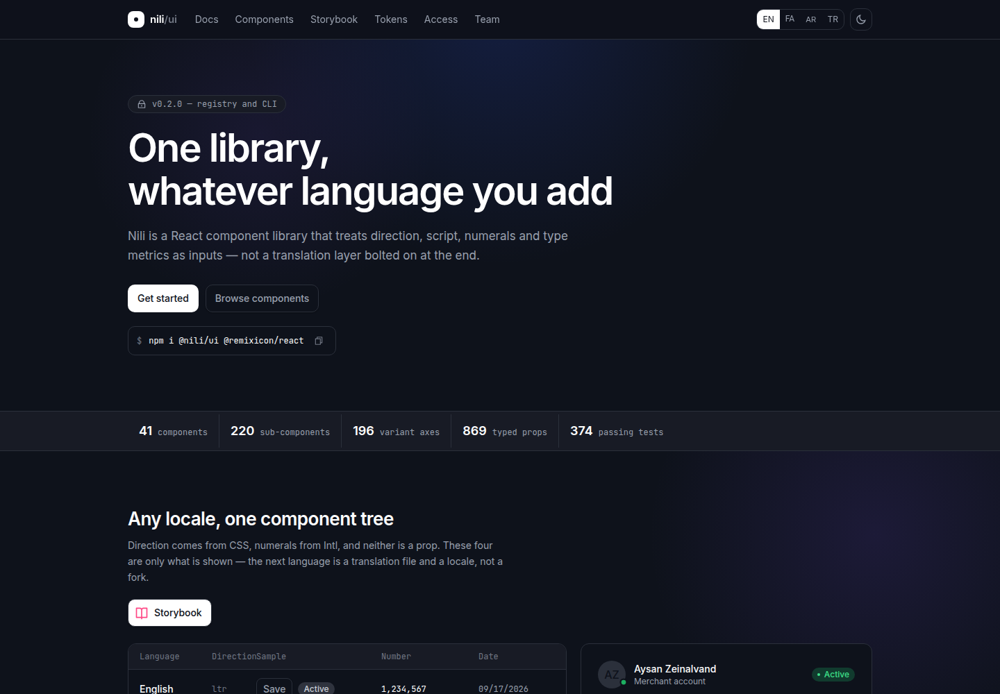
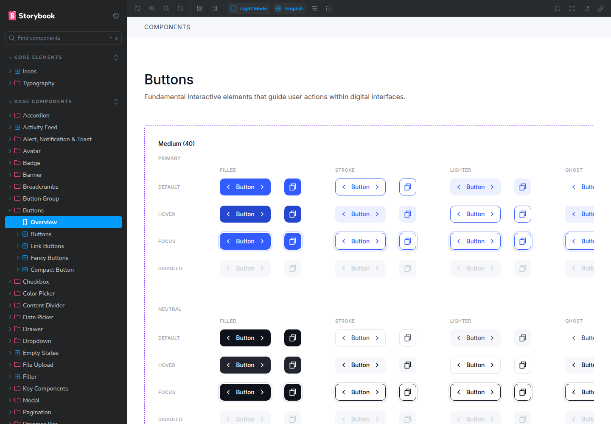

# Nili Design System

A React design system for Persian and English interfaces, built with TypeScript and Tailwind CSS. Nili brings RTL support, consistent typography, and customizable themes to reusable UI components.

| Website & Docs | Storybook |
| :---: | :---: |
| [](https://nili.aysanz.dev) | [](https://nili-storybook.aysanz.dev) |
| [**Visit the website ↗**](https://nili.aysanz.dev)<br>Discover Nili and read the docs. | [**Open Storybook ↗**](https://nili-storybook.aysanz.dev)<br>Explore components and try their variants. |

## Features

- RTL and LTR layouts with Persian and English support.
- Light, dark, and system themes with CSS variable customization.
- Components for forms, navigation, overlays, and data display.
- Date picker with Jalali and Gregorian calendars.
- Persian number formatting and Inter / Vazirmatn typography.
- Interactive component examples in Storybook.

## Getting started

Use Node.js 20 or later and npm. Clone the repository and start Storybook:

```bash
git clone https://github.com/AysanZ/Nili-Design-System.git
cd Nili-Design-System
npm install
npm run storybook
```

Open [localhost:6006](http://localhost:6006) to explore the components.

## Development

Run these commands from the repository root:

| Command                   | Description                                      |
| ------------------------- | ------------------------------------------------ |
| `npm run storybook`        | Start Storybook                                  |
| `npm run www`              | Start the documentation site at `localhost:3000` |
| `npm run studio`           | Start the visual component editor                |
| `npm run build`            | Build the component library and styles           |
| `npm run build-storybook`  | Build the static Storybook site                  |
| `npm run test`             | Run the library tests                            |
| `npm run typecheck`        | Check library TypeScript types                   |
| `npm run lint`             | Run ESLint                                       |
| `npm run registry`         | Regenerate the component registry                |

## Project structure

```text
src/           Components, providers, hooks, utilities, and styles
apps/www/      Documentation website
apps/studio/   Visual component editor
packages/cli/  CLI for copying components into your project
registry/      Generated component metadata and source files
```

## Contributing

Bug reports, feature requests, documentation improvements, and pull requests are welcome. For UI issues, include the component name, language, theme, and steps to reproduce.

Before submitting a pull request, run `npm run typecheck`, `npm run test`, and `npm run lint`. Update the relevant stories and tests when changing component behavior.
